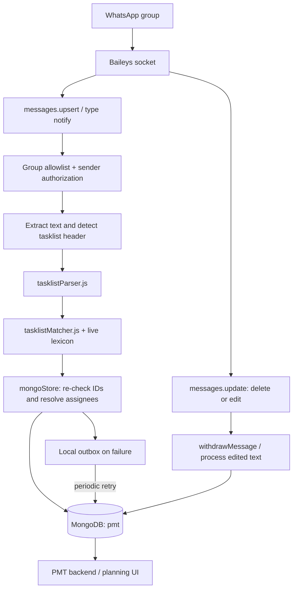
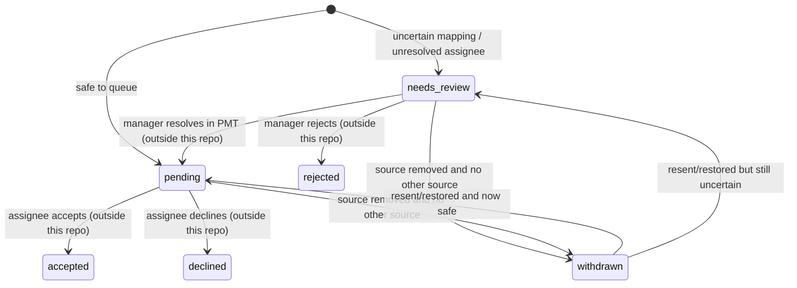

# WhatsApp Task Assignment Listener — Architecture, Data Model, Idempotency, and Edge-Case Review


> **Code snapshot update — 2026-10-16**
>
> This document has been revised against the uploaded repository snapshot `cdaaded015def4df5d84846b733052ffb7818ae6` (the archive root identifies this commit). It now reflects the group-ID allowlist, configurable filesystem outbox, atomic temp-file writes, durable delete/edit withdrawal events, source-ID atomic updates, poison-payload quarantine, connection-state health endpoints, reconnect backoff/single-socket guard, `SIGTERM` handling, and expanded message-text extraction.
>
> **Verification note:** the repository contains tests for these paths. In this execution environment, 95 tests passed and 3 test files/cases could not run because the installed dependencies `express` and `@whiskeysockets/baileys` were absent. This is an environment limitation, not evidence that those tests fail when dependencies are installed. The repository owner reported that all 103 tests passed in their environment; this document does not treat that report as a live WhatsApp integration test. The live Baileys connection and Render deployment were not exercised here.
>
> **Important distinction:** these changes materially improve resilience but do not make the listener “foolproof.” The outbox is still a filesystem spool, not a Mongo-backed queue; message identity and logical-task identity still have known limitations documented below.

**Reviewed artifact:** `task_assignment_automation-main (1).zip` (snapshot `cdaaded015def4df5d84846b733052ffb7818ae6`)  
**Review date:** 16 October 2026  
**Primary runtime entry point:** `index.js` (`package.json` sets `main` to `index.js`)  
**Primary persistence implementation:** `mongoStore.js`  
**Parser / matching implementation:** `tasklistParser.js`, `tasklistMatcher.js`, `lexiconBuilder.js`, `textUtils.js`  
**Primary database:** MongoDB database selected by `MONGODB_DB` (defaults to `pmt`)

> **Reading convention:** “Current behavior” means behavior directly represented in the uploaded code. “Risk / caveat” identifies an implementation limit or an assumption that needs verification. “Recommendation” is proposed hardening, not a claim that the code already does it.

> **Scope limitation:** This ZIP contains the listener and its tests, not the PMT backend. The source comments say the PMT planning backend reads `tasklist_items`; this review documents the records this listener writes and the lifecycle contract it expects. It does not independently verify every downstream PMT API/UI behavior.

---

## 1. Executive summary

This is a **WhatsApp group-message ingestion service with a deterministic, lexicon-backed NLP matching pipeline**. It is not currently calling an external generative LLM. “NLP” here means normalization, tokenization, stemming, fuzzy word matching, weighted lexical scoring, alias resolution, ambiguity thresholds, and a rule-based parser.

A manager posts a tasklist in an allowed WhatsApp group. The service checks the group and sender, extracts supported text, recognizes a team header, parses assignee/task sections, and matches task text against a lexicon built from PMT clients, projects, and deliverables. The listener then writes a tasklist-level record and one **logical task record per expanded task line** to MongoDB. If it cannot safely resolve a field or assign a user, it generally creates a `needs_review` record rather than silently routing it to the wrong person.

The most important architectural distinction is:

- **WhatsApp message:** the source artifact and its identity.
- **Tasklist:** one parsed message, including original text, calls, and parser warnings.
- **Task item:** one unit of work that PMT can display and move through a lifecycle.
- **NLP match log:** an audit record of how one parsed line was resolved.
- **Logical-task deduplication:** re-posting the same task on the same work date normally reuses the existing task item rather than creating a second one.

### Main guarantees the code is aiming for

1. **Conservative matching:** ambiguous client/project/deliverable mappings, stale references, and unresolved or cross-team assignees are held for review.
2. **Per-day logical-task deduplication:** a unique MongoDB index and deterministic `dedupe_key` prevent the same normalized line for the same assignee and work date from being inserted twice, assuming the indexes exist and the input normalizes the same way.
3. **Preserve acted-on work:** replays, edits, or deletions should not rewrite or withdraw tasks that have already been accepted/declined (or otherwise moved out of the “waiting” statuses).
4. **Duplicate-source tracking:** when another message repeats a task, its message ID is added to `source_message_ids`; deleting one source should not withdraw a task still asserted by another message.
5. **Offline persistence attempt:** if MongoDB writes fail, the full payload is written to a local `outbox/` JSON file and retried.
6. **Live-data revalidation:** the initial lexical match is rechecked against current client/project/deliverable records before being queued.

### Guarantees that need qualification

- The local outbox is only durable as long as the instance’s filesystem survives. A local directory is not automatically durable across a Render redeploy/replacement.
- Mongo writes span several collections without a transaction. Upserts make retries mostly safe, but do not make the multi-collection write atomic.
- Message handling and source-ID updates are not globally serialized. Concurrent duplicate events can race, and the in-memory test database does not prove production concurrency behavior.
- The delete/edit path has no durable retry queue when MongoDB is unavailable.
- The production `index.js` text extraction handles fewer WhatsApp message wrappers/types than `index-terminal.js`; the package entry point is `index.js`.
- Health endpoint `/` reports a static “listener active” string; it does not prove WhatsApp or MongoDB is healthy.

---

## 2. System overview



### Main modules and responsibilities

| File | Responsibility | Important boundary |
|---|---|---|
| `index.js` | WhatsApp connection, group/sender gates, message text extraction, parser invocation, payload assembly, delete/edit handling, Express health/QR endpoints | Owns ingestion; doesn’t implement NLP scoring itself. |
| `tasklistParser.js` | Detects team/list headers; splits a message into assignee sections, task lines, quantities, comma-separated deliverables, and calls | Converts message text into structured line-level candidates. |
| `tasklistMatcher.js` | Matches text to database entities using weighted tokens, fuzzy matches, aliases, score thresholds, alternatives, ambiguity rules | Produces heuristic scores, not calibrated probability values. |
| `lexiconBuilder.js` | Converts PMT clients/projects/deliverables into a searchable lexical index and IDF weights | Excludes hidden/merged projects from normal matching; handles deliverables of merged projects. |
| `textUtils.js` | Normalization, tokenization, stemming/synonyms, fuzzy edit-distance comparison | Shared matching primitives. |
| `mongoStore.js` | User mapping, live lexicon refresh, live ID validation, task document construction, Mongo upserts, outbox, deletion/edit withdrawal, NLP logs | Canonical writer for `tasklist_items`. |
| `waAuthStore.js` | Stores Baileys credentials and key material in MongoDB under `wa_auth` | Separate from task data; highly sensitive session material. |
| `qrPage.js` | Optional password-protected QR PNG endpoint | Enabled only when `QR_PAGE_TOKEN` is long enough. |
| `teamRoster.json` | Bundled known-name list used by the parser | Recognition is not the same as successful PMT user resolution. |
| `clientAliases.js` | Client alias/family knowledge used by matching | Alias coverage directly affects match quality. |
| `lexicon.json` | Startup fallback lexical snapshot | Live Mongo data is intended to replace it when available. |
| `index1.js` | Older listener variant that forwards to n8n | Not the configured `package.json` main entry point. |
| `index-terminal.js` | Terminal-only variant with different extraction/reconnect behavior | Not the configured `package.json` main entry point; do not assume its handling exists in production. |

### Not an external LLM workflow

There is no API call to a hosted LLM in the path above. A task like “ICICI Prudential Pharma - From Lab to Life (Review & Changes)” is decomposed by code and ranked against known entity names. Any reference to “confidence” is a heuristic score derived from lexical overlap—not a statistical probability that a match is correct.

---

## 3. End-to-end processing, step by step

### 3.1 Startup

1. `index.js` loads environment variables and starts the Express server.
2. `store.init()` attempts MongoDB connection, pings the configured database, creates indexes, loads users, and tries to flush any outbox files.
3. The live lexicon is refreshed from PMT data when available.
4. `startWhatsApp()` chooses authentication storage:
   - Mongo-backed session from `wa_auth` if `store.getDb()` is connected and `WA_AUTH_STORE` is not `file`.
   - Otherwise, the legacy `./auth_info` file directory.
5. A Baileys socket is created and listeners are registered for credential changes, connection updates, new messages, and message updates.

**Startup caveat:** `store.init()` catches a connection failure and returns `false`, so WhatsApp can start using file-based auth while Mongo retries in the background. The auth store is selected once at startup; reconnecting Mongo later does not hot-switch that already-created WhatsApp socket to Mongo-backed auth. If Mongo starts down and then comes back, task persistence can recover while auth remains file-based until a restart.

**Startup caveat:** if Mongo connects but index creation fails (for example, a unique index cannot be built because old duplicates already exist), `store.init()` rejects. The top-level chain then logs “FAILED TO START WHATSAPP” and does not proceed to `startWhatsApp()`.

### 3.2 New-message gate (`messages.upsert`)

The main listener only processes batches where Baileys reports `type === "notify"`. Other batch types are logged and skipped.

For each message:

1. Empty messages are skipped.
2. `status@broadcast` is ignored.
3. Private chats are ignored; the JID must end with `@g.us`.
4. Group metadata is fetched and the current group subject is read when available.
5. `groupGate.isGroupAllowed(remoteJid, groupName)` checks `ALLOWED_GROUP_JIDS` if the list is populated; otherwise it falls back to normalized `ALLOWED_GROUP_NAMES`.
6. Sender authorization is checked:
   - messages sent by the linked account (`key.fromMe === true`) are treated as manager messages; or
   - sender/alternate sender numbers must match a configured `MANAGER_JIDS` value on the last 10 digits.
7. Text is extracted by `messageText.js`, including normal/extended text, supported media captions, and the disappearing/view-once/document-caption wrappers covered by its tests.
8. Keyword matches are calculated for logging, but **keywords are not a processing gate**.
9. The team/list header is detected. If it is a tasklist, known assignee names are assembled and the database lexicon is refreshed if stale.
10. The entire message is parsed into `parsed_tasklist`.
11. A payload is formed, retaining message identity, group, sender metadata, raw text, parser output, lexicon timestamp, WhatsApp timestamp, and an optional work-date override.
12. For tasklists, `store.saveTasklist(payload)` persists or queues the payload. A non-tasklist manager message is not stored in the task collections.
13. If `FORWARD_TO_N8N=true` and a webhook URL exists, the payload is also sent to n8n. This optional forwarding occurs for manager messages with extracted text, even if the text is not recognized as a tasklist.

**Failure boundary:** group-metadata fetch failures are logged and the message is skipped; that failure does not use the outbox. The normal task-save path has an outbox, but failures earlier in ingestion are not durably retried by this module.

### 3.3 Text extraction in the configured production entry point

`index.js` extracts:

- `conversation`
- `extendedTextMessage.text`
- `imageMessage.caption`
- `videoMessage.caption`

Other message shapes are ignored as “non-text message.” In particular, this code does not recursively unwrap `ephemeralMessage`, `viewOnceMessage`, `documentWithCaptionMessage`, or button/list replies, and it does not read document captions. `index-terminal.js` has a more defensive recursive extractor for several of those shapes, but that code is not used by `package.json`’s main entry point. This is a concrete implementation difference, not just a theoretical edge case.

### 3.4 Tasklist detection

`detectTeam()` inspects the first three non-empty message lines and looks for a header matching the supported team names: `content`, `design`, or `animation`, followed by `team`, `tasklist`, or equivalent supported header wording. A matching header makes `isTaskListMessage()` return true.

`KEYWORDS` does **not** decide whether a message is stored. It produces a list of substring hits for diagnostic output. For example, `KEYWORDS=content,design,animation,tasklist` can show a hit, but a message without a recognized team header will still be treated as non-tasklist.

### 3.5 Parser context and lexicon refresh

For a tasklist, known parser-side assignees are assembled from:

1. `ASSIGNEES` in environment variables;
2. active PMT users resolved by `store.loadUsers()`; and
3. names in `teamRoster.json`.

The `users` cache lives for 10 minutes unless forced. The lexicon refresh threshold is 5 minutes by default (`LEXICON_MAX_AGE_MS`). A live refresh reads `projects`, `deliverables`, and `clients` from MongoDB. It will not replace a working lexicon if the client or project read is empty.

This two-stage naming arrangement is deliberate:

- The parser’s “known name” list decides whether a line looks like an assignee header.
- `resolveAssignee()` later decides whether that name maps uniquely to an eligible PMT user in the right department.

Therefore, **“the parser recognized the name” does not mean “the task was successfully assigned.”** A roster/env-only name can parse successfully and still end up in `needs_review` because no PMT user maps to it.

### 3.6 Live reference validation

After matching, `mongoStore.loadReferences()` fetches the specific client/project/deliverable IDs mentioned in parsed tasks. `validateRefs()` checks that:

- the client still exists;
- the project still exists;
- the project is not hidden;
- the project is not a merged duplicate;
- the project still belongs to the matched client; and
- the deliverable still exists and belongs to the selected project.

Invalid IDs are cleared from the fields used for routing, while names and `nlp_ids` retain evidence of the original match. The item is held for review when these checks raise problems. This protects against stale lexicon IDs leaking directly into a live PMT assignment.

Exception: when the client is explicitly named, a user is uniquely mapped, and the only issue is that the project is not yet in PMT, the task can be queued as `pending` with `project_unconfirmed: true` and `project_id: null`. This is an intentional business rule: the task is useful enough to show to the assignee, but its project still needs confirmation. A guessed client or ambiguous project does not qualify for this exception.

---

## 4. Parsing rules and NLP matching, in depth

## 4.1 Supported tasklist shape

Typical supported shape:

```text
Content Team
Harshal
- ICICI Prudential Pharma - From Lab to Life (Review & Changes) - High Priority
- Bandhan One Idiot Campaign

Vanshika, Ratnesh
- TFP Premium - 2 Minimalist

Calls for today:
- ICICI TVC - Vanshika
```

A task line is associated with the most recently recognized assignee header. A multi-person header duplicates each task under each listed person. Lines before the first assignee header become warnings and are ignored as tasks.

### Headers and formatting

- Bullets include common hyphen/bullet characters and numbered forms.
- WhatsApp formatting wrappers are stripped from the start/end of lines.
- Numeric and named HTML entities are partially decoded (`&#x20;`, numeric entities, `&nbsp;`, `&amp;`).
- Team header detection accepts the first three non-empty lines, so the header does not have to be the literal first line.
- Assignee headers may be one name, full names, or multiple names separated by commas, `/`, `&`, `+`, or the word `and`.
- A short or bold name-like line immediately before a bullet can be accepted as an assignee header even if the name is not known; the parser emits a warning, and persistence then decides whether the user exists.
- Calls/meetings start a separate section. Once the parser reaches `Calls for today`, `Calls for tomorrow`, or a similar supported calls/meetings header, later lines are interpreted as calls, not tasks.

### Multi-assignee behavior

If the header says `Aniket, Vaishnavi`, every task line below it is expanded into one parsed task for Aniket and one for Vaishnavi until another assignee header or calls section is reached. This is not a collaborative task record; it is two assigned task items.

If the name is unknown but accepted as a header, parsing continues. It is later held because `resolveAssignee()` cannot find a unique PMT user. This avoids silently dropping a manager’s intended assignment while avoiding routing to a made-up user.

### Comma-separated deliverables

A comma can mean two deliverables when it occurs in the deliverable part of a task line. The splitter tries to avoid breaking:

- commas inside brackets/parentheses;
- numbers such as `1,000`;
- known deliverable names in the PMT database that contain a comma; and
- the client/project portion before the first separator.

For example, `TFP Premium - 1 IG, 1 Minimalist` is expanded into two entries, while `FT US Equity - Your US Exposure, From GIFT City - Minimalist` is intended to preserve the embedded comma in the known deliverable name.

**Edge:** comma meaning is contextual. An unfamiliar deliverable name that legitimately contains a comma is not protected by the database phrase list, so it may be split. Conversely, an unusual task format with commas in the deliverable part may be treated as one deliverable if the entire phrase matches a known comma-bearing deliverable.

### Quantity expansion

The parser splits quantities into one item per unit for counts from 2 through 10 in supported positions. For example:

`TFP Premium - 2 Minimalist`

becomes two equivalent task candidates with unit text `1 Minimalist`, carrying `copy_index` values 1 and 2 and `copy_total: 2`. Quantities combine with comma splitting when the recognized shape is supported.

Counts are **not** expanded in all textual positions. A count of 1, a lone number, a likely project label such as `Phase 2`, a singular-label form such as `Creative 2`, or a line with two quantity declarations does not get guessed into many tasks. Quantity words are handled by regular expressions and a simple plural heuristic, not full grammar; irregular plurals or unfamiliar noun patterns may not singularize correctly.

### Priority, action, notes, and slot

- Phrases such as `High Priority`, `Medium Priority`, `Low Priority`, and `Urgent Priority` are removed from the matched task text. The PMT worksheet does not use this priority value in the current path; the parsed priority field is effectively not populated by the database matcher. The optional legacy `tasks` output defaults priority to `Normal`.
- Action-like words such as review/reviews, changes, ideation, scripting, updation, revamp, edits, rework, and new script can be separated into `action`.
- Bracketed text becomes `notes` (joined with semicolons).
- Conditions such as `once scripts are approved`, `after approval`, and similar recognized wording become notes.
- `first half` / `second half` becomes `slot`.
- Some phrases (for example `campaign ideation`) are protected so the action-word extraction does not accidentally split a legitimate deliverable name.

**Edge:** these are rule lists. New internal vocabulary, new action words, or novel condition wording should be added with regression tests; otherwise the words may remain in the deliverable text or be extracted in an unintended way.

## 4.2 Matching source and normalization

`lexiconBuilder.js` turns PMT projects and deliverables into tokenized entities. Each project token and deliverable token has an inverse-document-frequency weight:

`idf(token) = ln(1 + N / documentsContainingToken)`

A rarer token contributes more evidence than a generic token such as “creative” or “campaign.” Client aliases are stripped from entity tokens so a repeated client name does not overwhelm project/deliverable matching.

`textUtils.js` performs normalization:

- Unicode decomposition and accent-mark removal;
- lowercasing and punctuation-to-space normalization;
- `&` → `and`;
- common stop-word removal;
- stemming for common plural forms;
- explicit variants such as `scripting`/`scripts` → `script`, `updation` → `update`, `pptx` → `ppt`, `sr` → `senior`, and typo correction such as `robecco` → `robeco`;
- compound normalization for words such as `multicap` / `multi cap`;
- fuzzy comparison for sufficiently long tokens, allowing small edit distances or prefix variants.

Numbers are not fuzzily matched as words. Short words also have tighter matching behavior to reduce false-positive matches.

## 4.3 Score calculation and thresholds

The core `rank()` function calculates weighted recall and precision for each project or deliverable candidate. Candidates are indexed by token to avoid scanning every possible row blindly.

| Rule | Current value / behavior | Interpretation |
|---|---|---|
| Minimum matching evidence mass | `MIN_MASS = 5.0` | A candidate normally needs at least this much weighted overlap. |
| Minimum raw project score | `PROJECT_MIN_SCORE = 0.30` | A project candidate below this is not “strong.” |
| Minimum raw deliverable score | `DELIVERABLE_MIN_SCORE = 0.60` | Deliverable matching requires a higher score than project matching. |
| Project score weighting | `0.70 × recall + 0.30 × precision` | Projects can be mentioned by only part of their full name. |
| Deliverable score weighting | `0.50 × recall + 0.50 × precision` | Deliverable match balances name coverage with avoiding over-broad matches. |
| Client tie margin | `0.05` | Close evidence for multiple clients triggers review. |
| Project ambiguity margin | `0.15` | Close projects usually trigger review unless a special tie-break rule cleanly distinguishes them. |
| Deliverable ambiguity margin | `0.10` | Close top deliverables trigger review in `mongoStore.js`. |
| Project recency prior | up to `0.04` added for ranking | A more recently updated project gets a small ranking nudge; raw score remains separately stored. |
| Exact unique deliverable escape hatch | raw ≥ `0.95`, recall ≥ `0.999`, precision ≥ `0.9`, at least 3 tokens, wording unique | Can infer client/project from a distinctive full deliverable name. |

The scores are **ranking features, not calibrated confidence probabilities**. A score of `0.90` should not be communicated as “90% probability of correctness.”

## 4.4 Candidate tie-break and review logic

The matcher has several exception rules to avoid simplistic “highest score wins” behavior:

- It prefers supported candidates with enough evidence mass over candidates based only on generic words.
- If no client is named, it uses project/deliverable evidence to vote for a client; a close client tie is held.
- It can infer a client from a distinctive project word or a unique exact deliverable.
- It does not trust a generic deliverable (for example, `Teaser`) to identify a client/project when that wording is shared across many records.
- A deliverable can imply its owning project when the exactness/owner evidence is strong enough. If not, the item is held with an explanation that the deliverable wording exists under a project not clearly named by the message.
- “PPT,” “storyboard,” “shoot AV,” and similar work-kind tokens may break a close project tie when one project fits the requested work kind and the other does not.
- Language tokens such as Hindi/Kannada/Marathi may imply a translation project.
- An active project may win over closed/non-active alternatives in a narrow case, but this does not lift weak-match uncertainty generally.
- Duplicate project rows that have the same name and client are not considered a meaningful human choice by the ambiguity rule.
- Merged/hidden project references are filtered or remapped when building the lexicon, and then checked again before writing.

### Why the same line can yield `pending` on one occasion and `needs_review` on another

Matching depends on the lexical catalog at the time of parsing. It can change as projects and deliverables are renamed, moved, merged, or added. The current system records the lexicon build timestamp, scoring details, candidates, and reasons to make that difference diagnosable. However, an already-persisted same-team waiting item is not generally re-matched on every replay; see the idempotency section.

---

## 5. MongoDB data model: how tasks are actually stored

The listener’s persistence contract centers on `tasklist_items`. There are supporting collections for source message metadata, tasklist-level data, NLP observability, WhatsApp authentication, and an optional legacy task format.

## 5.1 Collection map

| Collection | Meaning | Written by listener? | Consumed as PMT task record? |
|---|---|---:|---:|
| `whatsapp_messages` | One raw message metadata/content record per tasklist message | Yes | No; source/diagnostic record |
| `whatsapp_tasklists` | One tasklist envelope per tasklist message, including calls and parser warnings | Yes | Not the per-task record |
| `tasklist_items` | One logical assigned work item per expanded task line/copy/person | Yes | **Yes, according to code comments** |
| `nlp_match_logs` | One NLP decision log row per parsed line/sequence/message | Yes | No; observability/audit |
| `tasks` | Legacy flat task rows from older n8n integration | Only when `WRITE_TASKS=true` | Comments say PMT no longer reads it |
| `wa_auth` | Baileys credentials and key material | Yes, by `waAuthStore.js` | Not task data; authentication secrets |
| `users` | PMT users used to resolve assignees/managers | Read-only | Existing PMT collection |
| `clients`, `projects`, `deliverables` | PMT master data used by matching and live validation | Read-only | Existing PMT collections |

The code comments explicitly say it does not write to `work_items` or other existing collections as part of this listener flow. `tasklist_items.work_item_id` starts as `null`; the downstream PMT app can populate it as work is acted on, but that behavior is outside this ZIP.

## 5.2 `whatsapp_messages`: source-message row

One row is upserted with `$setOnInsert`, keyed by `message_id`.

| Field | Purpose |
|---|---|
| `message_id` | WhatsApp message ID or edited-message synthetic ID |
| `chat_id` | Group JID |
| `group_name` | Group subject at processing time |
| `sender` | Usually the literal `MANAGER` for authorized manager messages |
| `from_manager` | Authorization result from ingestion |
| `is_group` | True for the accepted group path |
| `message` | Extracted text (not necessarily the full original WhatsApp protocol envelope) |
| `received_at` | Listener-side timestamp, generated during persistence |
| `processing_status` | Set to `Processed` at insert time |

**Important:** although this collection is named `whatsapp_messages`, this path calls persistence only for recognized tasklists. It is not a complete archive of every WhatsApp message seen by the process. Replays under the same `message_id` do not update the original row because the operation is `$setOnInsert`.

## 5.3 `whatsapp_tasklists`: tasklist envelope

One document per tasklist message, upserted by unique `message_id`.

| Field | Purpose |
|---|---|
| `id` | Random UUID generated when constructing a new envelope |
| `message_id` | Source message ID (unique key) |
| `chat_id`, `group_name` | Source group details |
| `sender_number` | Alternate sender number if available, otherwise sender number |
| `team` | Detected team (`content`, `design`, or `animation`) |
| `work_date` | India-local calendar date for the message, or original date for an edit |
| `raw_text` | Full extracted tasklist text |
| `task_count` | Number of expanded parsed task candidates, not necessarily number of new database inserts |
| `calls` | Parsed call/meeting rows from the calls section |
| `warnings` | Parser warnings such as unknown assignees or lines before an assignee |
| `parser.lexicon_built_at` | Which lexical snapshot was used for matching |
| `parser.method` | `match_method` of the first task if one exists; null if none |
| `source` | `whatsapp` |
| `created_at` | Listener persistence time |
| `withdrawn_at`, `withdrawn_reason` | Added when the message is deleted/withdrawn or an edit withdraws the old source |

`calls` are stored in this envelope, not expanded into `tasklist_items`. The current listener does not assign calls as task items in this flow.

## 5.4 `tasklist_items`: canonical PMT work item

This is the most important schema. One document represents **one assignee’s one unit of work on one work date**. If one task is assigned to two people, two task items are generated. If a quantity of two is expanded, two task items are generated. If the exact same normalized line is repeated without quantity/copy identity, the duplicate is generally collapsed.

### Identity and source tracking

| Field | Meaning |
|---|---|
| `id` | Random UUID assigned when the logical item is first inserted. Replays/restores preserve it. |
| `message_id` | Message ID that originally created this item. It is not rewritten for every repost. |
| `source_message_ids` | Message IDs that have asserted this logical task; a replay/repost can append an ID. For waiting tasks, deleting the last source clears the list; for an acted-on task, the current code can retain the last deleted source ID because it preserves the task rather than withdrawing it. |
| `seq` | Sequence number of the parsed/expanded item within that message. It is useful for audit/log alignment, but not the task uniqueness key. |
| `work_date` | India-local day used in the logical dedupe scope and task plan. |
| `dedupe_key` | SHA-1-derived 20-hex-character digest of normalized work date/assignee/line plus copy/duplicate markers where applicable. |
| `source` | `whatsapp` |

### Assignment and team fields

| Field | Meaning |
|---|---|
| `team` | Detected message team, not independently inferred from the recipient |
| `team_mismatch` | True when the named assignee exists but belongs to another department than the list team |
| `assignee_name` | Name text selected by the parser/configured known-name list |
| `assignee_user_id` | PMT `users.id` if a single eligible user is resolved, otherwise null |
| `assignee_pmt_name` | Canonical PMT user name, if resolved |
| `assigned_by_user_id` | PMT user ID mapped from the sender using `MANAGER_MAP`, otherwise null |
| `assigned_by_name` | Mapped sender name, otherwise e.g. `Content team manager` |
| `assigned_by_role` | Role/department description or fallback label |

### Client/project/deliverable fields

| Field | Meaning |
|---|---|
| `client_id`, `client_name` | Client from the lexical match, after live existence validation clears invalid IDs |
| `project_id`, `project_name` | Resolved project ID/name; ID can be null if not confirmed or no matching project exists |
| `project_text` | Text interpreted as a project hint; can retain a new/unmatched project phrase |
| `project_unconfirmed` | Special state used when the client is explicitly named and otherwise safe task can be queued before its project exists/is matched |
| `deliverable_name` | Parsed deliverable/work label from the line |
| `db_deliverable` | Canonical matched PMT deliverable name, for audit/reference |
| `deliverable_id` | Resolved deliverable ID after live validation; null if missing/stale/invalid |
| `action` | Extracted action such as Review/Changes/Ideation, if recognized |
| `notes` | Bracketed/condition notes |
| `slot` | `First half` / `Second half`, if recognized |
| `priority` | Field exists, but current matching rules strip priority phrases and do not populate a meaningful priority value |

### Planning, match, and review fields

| Field | Meaning |
|---|---|
| `due_at` | `${work_date}T18:00:00+05:30`, i.e. 18:00 India time by default |
| `est_minutes` | Initially `null`; this tasklist format carries no estimate |
| `confidence` | Heuristic score object for client/project/deliverable, not probability calibration |
| `client_source` | How client was selected, e.g. `name in text`, `inferred from database match`, `inferred from project`, or `corrected by project match` |
| `alternatives` | Competing project candidates/scores for review |
| `nlp_ids` | The original matcher’s client/project/deliverable IDs before live checks; retained even if routing IDs get cleared |
| `needs_review` | Boolean flag controlling initial review/queue behavior |
| `review_reasons` | Deduplicated textual reasons for holding the item |
| `status` | Initially `needs_review` or `pending` |
| `work_item_id` | Initially null; downstream PMT linkage slot |
| `accepted_at`, `declined_at`, `decline_reason` | Lifecycle fields initialized null |
| `questions` | Array initialized empty |
| `history` | Lifecycle audit array, with an initial `flagged` or `queued` entry and later system restore/re-team/withdraw entries |

### Raw line and quantity identity

| Field | Meaning |
|---|---|
| `raw_line` | Parsed/expanded line text. For quantity expansion, this may be transformed to `1 <unit>` rather than the exact original line. The full original message remains in `whatsapp_tasklists.raw_text`. |
| `copy_index`, `copy_total` | Set for quantity-expanded copies, e.g. 1 of 2 and 2 of 2; otherwise null |
| `dup_index` | Used for a certain class of separate lines whose splitting creates the same text; null for ordinary lines |
| `created_at`, `updated_at` | Initial insertion and later update timestamps |
| `withdrawn_at` | Added when a waiting task is withdrawn; not part of the initial inserted shape |

### Initial task-item statuses

- `pending`: the record passed the review gates and is eligible to be surfaced to its resolved assignee.
- `needs_review`: the record was parsed but is not safe to deliver yet. The assignee may be unresolved, team-mismatched, or client/project/deliverable mapping may be uncertain/stale.
- `withdrawn`: a previously waiting task no longer has an active source message and is withdrawn due to delete/edit; it is kept as a historical record rather than physically deleted.

The rest of the lifecycle is consumed/managed outside this listener. The code comments describe manager review to `pending` or `rejected`, and assignee response states `accepted` / `declined`. The listener itself does not implement the full PMT UI workflow.

## 5.5 `nlp_match_logs`: one row per parsed line

The unique key is `{ message_id, seq }`, so the log identity is the task candidate’s position in one message—not the logical-task dedupe key.

Important fields include:

- `id`, `message_id`, `seq`, `work_date`, `team`;
- `raw_line`, `assignee_name`, `dedupe_key`, `match_method`, `lexicon_built_at`;
- `decision` (`queued`, `needs_review`, or `duplicate_line` for the first decision);
- `client_name`, `project_name`, `deliverable_name`, resolved IDs;
- per-field confidence and raw scoring detail (`raw`, `mass`, `recall`, `precision`);
- project/deliverable margin between the two top candidates;
- alternative candidates and review reasons;
- `validation_checked` and `validation_problems`;
- `last_seen_at`, `seen_count` maintained on replays.

A replay using the same `message_id` and `seq` increments `seen_count` and updates `last_seen_at`, but `$setOnInsert` preserves the first decision payload. If the matching result changes on a later replay under the same ID, the log may describe the first decision rather than the newest attempted decision.

## 5.6 Legacy `tasks` collection (opt-in)

`WRITE_TASKS=false` by default. If enabled, it writes a legacy flat row for each item that is not marked `needs_review`. The row has fields such as `task_code`, `due_date`, `department`, assignee, client/project/task labels, format/action, priority, status, notes, source message ID, IDs, dedupe key, and timestamps.

The source comments say PMT reads `tasklist_items`, not this legacy `tasks` collection. Turning `WRITE_TASKS=true` introduces a second representation and its own unique index; do so only if a consumer explicitly still requires it.

## 5.7 `wa_auth`: WhatsApp session data

`waAuthStore.js` serializes Baileys credentials and keys into MongoDB documents. IDs are formed as `<sessionId>:<file-like-key>`; the default session ID is `default`, overridable with `WA_SESSION_ID`. The session is separated from task collections but resides in the same configured database. It should be treated as secret key material and protected with least-privilege database credentials and appropriate Atlas/network access controls.

## 5.8 Indexes and what they promise

`ensureIndexes()` creates these indexes outside dry-run mode:

| Collection | Index | Purpose |
|---|---|---|
| `whatsapp_tasklists` | unique `{ message_id: 1 }` | One tasklist envelope per source/edit message ID |
| `tasklist_items` | unique `{ work_date: 1, assignee_name: 1, dedupe_key: 1 }` | Main logical-task idempotency constraint |
| `tasklist_items` | `{ status: 1, work_date: -1 }` | Status/date lookup |
| `tasklist_items` | `{ assignee_user_id: 1, work_date: -1 }` | Assignee/date lookup |
| `tasklist_items` | `{ assignee_user_id: 1, status: 1 }` | Assignee/status lookup |
| `whatsapp_messages` | unique `{ message_id: 1 }` | One source metadata row per message ID |
| `nlp_match_logs` | unique `{ message_id: 1, seq: 1 }` | One first-decision audit row per parsed line/message |
| `nlp_match_logs` | `{ decision: 1, created_at: -1 }` | Review/decision observability lookup |
| `tasks` | unique `{ due_date: 1, assignee: 1, dedupe_key: 1 }` when legacy writes enabled | Legacy logical-task uniqueness |

The code relies on these indexes for production idempotency. Existing duplicate rows can prevent index creation, and index-creation failures can block WhatsApp startup.

---

---

## 6. Idempotency rules: exact current semantics

Idempotency is not one single key. The implementation uses different identities at different layers. This section is the important answer to “what happens if the same message is delivered twice?”

## 6.1 Three separate idempotency layers

### Layer A — source-message identity

`message_id` is used to upsert one row in `whatsapp_messages` and one row in `whatsapp_tasklists`, both with `$setOnInsert` and unique indexes. `nlp_match_logs` uses `{ message_id, seq }`.

Effect: processing the same source ID repeatedly does not create a second tasklist envelope or raw message row. It also does not replace the original envelope/text on a replay; `$setOnInsert` means original content survives until a distinct edit ID is generated.

### Layer B — logical task identity

The main task item filter/index is:

```js
{
  work_date: 1,
  assignee_name: 1,
  dedupe_key: 1
}
```

The dedupe key is a SHA-1 digest of normalized pieces equivalent to:

```text
work_date | lowercased-assignee | normalized-raw-line [| #copyIndex] [| dupN]
```

Normalization currently:

1. lowercases the raw line;
2. strips a leading bullet/list-number pattern;
3. collapses repeated whitespace; and
4. trims surrounding whitespace.

It does **not** canonicalize the line to `client_id/project_id/deliverable_id`. It is text-based identity, not semantic task identity.

### Layer C — line-level NLP audit identity

`{ message_id, seq }` gives one log record for a line number within a particular source message. Replays increment `seen_count` and update `last_seen_at`. They do not create a second audit row for the same message ID/sequence.

## 6.2 Expected outcomes by scenario

| Scenario | Current expected result | Why |
|---|---|---|
| Same message ID delivered twice | One message row and one tasklist envelope; each logical task usually remains one task item | Unique message indexes and `$setOnInsert`; task dedupe also applies |
| Same task text reposted in another message on same work date, same assignee | Usually one task item; new message ID is appended to `source_message_ids` | Logical-task identity is independent of source message ID |
| Same line on a different work date | New task item | Date is part of both dedupe input and unique index scope |
| Same task assigned to another person | Separate task item | Assignee is part of logical identity |
| One task assigned to two names in a multi-person header | One candidate/item per person | Parser expands across assignees |
| `2 Minimalist` quantity | Two task items | `copy_index`/`copy_total` are included in dedupe identity |
| Same ordinary line appears twice in same message | Usually one task item; duplicate line may receive a `duplicate_line` NLP log | There is no arbitrary per-line uniqueness for normal repeats |
| Two separate source lines split into same sub-deliverable through comma parsing | Parser can add `dup_index` to distinguish intended separate units | Prevents certain valid split-line outputs from collapsing |
| Same source line, but whitespace/case/bullet formatting differs | Often dedupes if differences are limited to case, bullet prefix, or repeated whitespace | Those aspects are normalized |
| Punctuation, wording, or spelling changes in the raw line | May become a different task item even when it is semantically the same work | Dedupe is not semantic |
| Equivalent task entered as a first name vs full name | May become separate items if `assignee_name` differs | The logical key uses parsed text name, not only resolved `assignee_user_id` |
| Two people intentionally need two identical tasks on the same date under the same name | Will collapse unless quantity/copy or supported `dup_index` distinguishes them | The default rule interprets identical same-day same-person lines as duplicate reposts |

## 6.3 Why the key contains work date and assignee twice

The digest itself incorporates work date and lowercased assignee, and the Mongo unique index also has `work_date` and `assignee_name` as separate fields. This is partly redundant. It makes lookup/index scope explicit, but creates a case-sensitivity nuance: Mongo string matching for `assignee_name` is case-sensitive unless a collation is specified. The digest lowercases the name, but the compound unique index also compares the original `assignee_name` field. In normal operation the parser tries to use known canonical spellings; however, inconsistent config capitalization could allow duplicate records with the same digest under differently cased `assignee_name` values because the compound index sees different names.

## 6.4 The exact update behavior when a logical task already exists

After an upsert fails to insert because the logical key already exists, the code reads the current task item and branches:

1. **Existing status is `withdrawn`:** restore it using the fresh parsed document, but preserve the existing `id`, `created_at`, and `history`; update other fields; push a `restored` history event. It becomes `pending` or `needs_review` based on the newly built payload.
2. **Existing status is waiting (`needs_review` or `pending`) and the new team differs:** replace most of the task’s fields with the fresh document, preserve `id`, `created_at`, and existing history, and append a `re-teamed` event. This is the “fix the header and resend” recovery path.
3. **Otherwise:** do not refresh the task’s matching fields or status. If this message ID is not already in `source_message_ids`, append it. This preserves accepted/declined/other acted-on work and also avoids changing ordinary same-team pending/review items on a replay.

### Consequence to know cold

A repeat of an existing `needs_review` item with the **same team** does not automatically upgrade it to `pending` just because the lexicon or parser result has improved. A repeat of a same-team `pending` item likewise does not update its project/deliverable references if the master data changed. The only current automatic refresh cases are restoration from `withdrawn` and re-teaming while still waiting.

That is a consequential product decision: **replay is primarily duplicate suppression, not reprocessing.** If that is not desired, it needs an explicit re-evaluation policy that respects statuses and manager edits.

## 6.5 What exactly does “the same task” mean here?

It means the same `work_date`, exact parsed `assignee_name`, and same digest from the normalized expanded `raw_line` plus copy/duplicate markers. It does not mean:

- same `assignee_user_id` regardless of typed alias;
- same canonical project and deliverable IDs;
- same line after typo correction or semantic equivalence;
- same `source_message_id` only; or
- globally unique lifetime task independent of day.

This is a **daily planning dedupe policy**, not a permanent task master-data identity.

---

## 7. Task lifecycle and edit/delete semantics

## 7.1 State model intended by the code



The listener only directly creates `pending`/`needs_review` records and directly restores, re-teams, or withdraws records. The normal manager/assignee transitions are expected to be handled by the PMT application.

`WAITING_STATUSES` is exactly `['needs_review', 'pending']`. Therefore, any other status is treated as “do not automatically withdraw/re-team,” even if a future downstream status is introduced. This fail-safe is conservative but should be revisited when new statuses are added.

## 7.2 Delete / revoke behavior

On a WhatsApp `messages.update` containing a revoke stub, `index.js` calls `withdrawMessage(messageId, reason)`.

For every task item matching that message ID through `source_message_ids` or its original `message_id`:

1. Remove the deleted message ID from the source list when another source ID remains. Keep the task active; it is still asserted by another message.
2. If no source remains and status is `pending` or `needs_review`, mark it `withdrawn`, set `withdrawn_at` and `updated_at`, clear `source_message_ids`, and append a `withdrawn` history event.
3. If status is not a waiting status, leave the item’s lifecycle state unchanged because work may already be accepted/declined/in use.
4. Mark the corresponding `whatsapp_tasklists` envelope with `withdrawn_at` and `withdrawn_reason`.

This is a soft withdrawal: it preserves the row and history rather than deleting it.

### Delete edge cases

- **Task reposted in another message:** deleting only one source should not withdraw it.
- **Task already accepted/declined:** deletion does not roll it back. If that was the last source, the code currently leaves the deleted ID in `source_message_ids` for this acted-on item; the status is protected, but the source list can be stale.
- **Task has no other source and is waiting:** it becomes `withdrawn` and PMT is expected not to show it as live.
- **MongoDB unavailable:** `withdrawMessage()` returns `not connected` and the current event handler only logs the problem. There is no outbox record for this delete event, so a later Mongo recovery will not automatically replay that withdrawal.
- **Repeated delete update:** operation is mostly harmless when rerun, but exact counts can differ because already-withdrawn records are not counted as newly withdrawn.
- **Raw source message rows:** the code marks `whatsapp_tasklists` withdrawn; it does not correspondingly update the `whatsapp_messages` row’s `processing_status`.

## 7.3 Edit behavior

On an edit update, the code:

1. looks up the original tasklist’s `work_date`;
2. withdraws the original message ID using the same rules as deletion;
3. synthesizes a new message ID of the form `<original-id>~e<edit timestamp>`;
4. runs the new text through normal tasklist processing; and
5. passes the original work date as `work_date_override`.

This is “withdraw old version, ingest new version,” not an in-place overwrite of a tasklist envelope.

Expected behavior for an edited list:

- unchanged waiting task, no other source: old logical item is withdrawn, then the same dedupe key is found and the item is restored;
- removed waiting task: remains withdrawn;
- newly added task: inserted as a new item;
- unchanged task also asserted by another live message: it stays active and gains the new edit-source ID;
- accepted/declined tasks: not forcibly withdrawn or rewritten.

### Edit edge cases

- The synthetic edit ID depends on a timestamp supplied by Baileys or a `Date.now()` fallback. A repeated update with the same original ID and same timestamp can reuse the same synthetic ID; envelope/log upserts then preserve the first content under that synthetic ID. If the upstream event does not provide a stable unique edit revision identifier, repeated rapid edits need additional handling.
- If the original message was never stored, `workDateOf()` returns null and the new version falls back to its message timestamp/current time for the work date.
- The delete/withdraw operation is attempted before the edited content is persisted. If Mongo fails during withdrawal and the error is caught by the outer handler, the new version is not processed in that same handler.
- A task already accepted under an old version is intentionally not rolled back even if the edited text removes it. That avoids silently invalidating work someone may have started, but it can leave a historically accepted item for a task no longer present in the edited message.

## 7.4 Race-sensitive behavior

The source list is updated by read-modify-write: load current `source_message_ids`, calculate a new array, and `$set` it. Two concurrent replays/deletions for the same logical task could both read the same old array and overwrite one another’s additions/removals. The Mongo unique indexes protect insertion uniqueness, but they do not make this array mutation race-free. An atomic `$addToSet` / `$pull`, and conditional state transitions, would be safer for source tracking.

---

## 8. Error handling, retry, and durability matrix

## 8.1 Current write path (updated for the `cdaaded` snapshot)

`saveTasklist()` behaves as follows:

- If `DRY_RUN=true`, it builds and logs the would-be writes but does not persist tasklist data.
- If MongoDB is disconnected, it attempts to reconnect/initialize. If Mongo is still unavailable, it writes the payload to the configured filesystem outbox and reports whether the write actually succeeded.
- `OUTBOX_DIR` controls the outbox location. If unset, the default is `./outbox`; on Render this is normally ephemeral and can be wiped on redeploy. Set it to the mount path of a persistent disk to retain queued payloads across deploys.
- Outbox files are written to a temporary filename and renamed to the final `.json` filename. A failed write returns `false`; the listener must not claim that the payload was queued if the write failed. This reduces the chance that a partial JSON file looks like a complete event. It is an atomic rename pattern on the same filesystem, not a guarantee against every disk/device failure.
- Delete/edit withdrawal events are represented as `{ type: "withdraw", message_id, reason }` payloads in the same filesystem outbox if MongoDB is down. The flush worker routes these to `withdrawMessage()` and removes the file only after successful application.
- If MongoDB is connected, the listener persists to the relevant collections. If a multi-collection write fails partway through, the payload may be queued and replayed; correctness then depends on the upsert/index/idempotency rules, because there is no cross-collection MongoDB transaction.
- The flush worker reads queued JSON files, applies tasklist or withdrawal events, and removes a file after success. Corrupt JSON is moved to `outbox/failed/` immediately. Non-connectivity failures are counted in process memory and moved to `outbox/failed/` after `OUTBOX_MAX_ATTEMPTS` (default 10). Mongo connectivity failures do not increase the failure count toward quarantine.
- `/health` and `/` expose operational state including Mongo/WhatsApp/outbox status; `/ready` returns 200 only when WhatsApp is open and MongoDB is connected, otherwise 503. The root endpoint remains a liveness-style endpoint and returns 200 when the HTTP process is alive.

## 8.2 Failure matrix (updated)

| Failure point | Current behavior | Durability / recovery | Remaining caveat |
|---|---|---|---|
| Initial Mongo connection fails | Startup can continue; background retries occur; WhatsApp auth storage is selected at startup | Tasklist payloads can be spooled to the filesystem | If the configured outbox is ephemeral, a redeploy can erase it. Auth mode does not necessarily hot-switch when Mongo later recovers. |
| Mongo unavailable at task save | Listener attempts to write a complete JSON payload to outbox | `queued_in_outbox` is true only when the file write succeeds | If disk write fails, the event is not saved by this path; inspect logs/response and alert on this condition. |
| Process crashes while writing an outbox file | Temp-file + rename pattern | A half-written final `.json` should not be exposed as a complete payload | Atomic rename is filesystem-scoped and does not replace persistent storage, fsync guarantees, or backup. A stale `.tmp` file may require cleanup. |
| Mongo error partway through `persist()` | Payload may be queued for replay | Replayed writes rely on unique indexes/upserts and task-level idempotency | No transaction spans `whatsapp_messages`, `whatsapp_tasklists`, `tasklist_items`, and `nlp_match_logs`; partial state can exist until replay completes. |
| Outbox JSON is malformed | Moved to `outbox/failed/` | Removed from the hot retry loop for manual inspection | Quarantine folder itself needs persistence, monitoring, and an operator runbook. |
| Payload repeatedly fails for a non-connectivity reason | Failure count rises; after `OUTBOX_MAX_ATTEMPTS` it is moved to `outbox/failed/` | Prevents a poison payload from retrying forever in the hot queue | Attempt counts are held in process memory, so they can reset on restart; quarantine may take longer than 10 total attempts across restarts. |
| Mongo connectivity error during flush | Does not count toward the poison-payload limit | File remains queued for a later attempt | Backlog age and disk capacity still need monitoring. |
| Delete/edit arrives while MongoDB is down | A withdrawal event is written to outbox | It is applied during a later flush; withdrawal is designed to be idempotent | If the filesystem write itself fails, that event is not durably queued. Event filename identity is still based on message ID alone. |
| Concurrent repost/delete changes source links | `$addToSet` / `$pull` are used for modern rows with `source_message_ids` | Reduces lost-update races for the array | Legacy rows without that field use a compatibility read/modify/write path and remain more race-sensitive. |
| Group metadata fetch fails | Message may be skipped | No durable ingress queue is created at that point | WhatsApp may not redeliver the event; monitor skipped-message errors. |
| WhatsApp disconnects / session conflict | Reconnect is single-flight with exponential backoff, capped at 60 seconds; session conflict waits at least 30 seconds | Avoids multiple concurrent socket starts and aggressive reconnect loops | Live connection/session behavior still needs verification in Render logs. |
| Render sends `SIGTERM` | Shutdown handler attempts graceful shutdown | Gives sockets/timers a chance to close before termination | A hard kill or short platform grace period can still interrupt in-flight work. |
| Unique-index creation fails | Startup initialization fails rather than safely accepting writes without the expected constraints | Avoids silently running without key uniqueness | Existing duplicate data may require a deliberate cleanup/migration before startup succeeds. |

## 8.3 This is still a filesystem outbox, not a Mongo-backed transactional outbox

A Mongo-backed outbox cannot solve the specific failure mode where MongoDB is unreachable: it would be unavailable at the same time as the primary writes. The current filesystem spool is therefore a sensible fallback architecture **provided its storage is persistent and write failures are surfaced**. `OUTBOX_DIR` makes that location configurable, but does not automatically create or attach a Render persistent disk.

The outbox is not transactional with WhatsApp delivery or Mongo business writes. The listener can receive a WhatsApp message and then fail before saving either the Mongo documents or an outbox file. There is no distributed transaction spanning WhatsApp, the local filesystem, and MongoDB. Operationally, treat the outbox as a retry spool with explicit limits—not as a proof of exactly-once delivery.

The `failed/` directory is a quarantine/dead-letter *mechanism*, but not yet a complete dead-letter workflow: it does not itself notify an operator, create a ticket, or guarantee the payload remains available unless the containing disk persists. Quarantined files need inspection/replay procedures and alerting.

## 8.4 Retry timing, health, and reconnect behavior (updated)

- Mongo/outbox retry interval: the store's periodic retry/flush timer (currently five minutes by default in this code path).
- User cache TTL: 10 minutes.
- Lexicon refresh threshold: five minutes by default.
- WhatsApp reconnect delay: exponential backoff starting at 3 seconds and capped at 60 seconds; one reconnect timer is scheduled at a time. Session-conflict handling enforces a minimum wait of 30 seconds.
- `waStarting`, `reconnectTimer`, and `shuttingDown` guard the reconnect lifecycle. This is safer than the earlier fixed-delay reconnect path, but does not prove the remote WhatsApp session will always recover without operator intervention.
- `SIGTERM` is handled for deployment shutdown.
- `/` reports actual component state while remaining an HTTP liveness endpoint; `/ready` is the stricter readiness check (WhatsApp open and Mongo connected). A 503 from `/ready` means the process may be alive but is not ready to handle normal work.
- `outbox_failed` reports the number of quarantined JSON files currently visible in the configured folder. It is a count, not an alerting mechanism or a measure of the oldest queued event.
- Quarantine retry counts are in-memory state in this snapshot. A process restart can reset counts for a repeatedly failing payload, so the “10 attempts” threshold is not necessarily a durable lifetime-attempt cap.

---

## 9. Authorization and security boundaries

### Allowed groups

`groupGate.js` supports both `ALLOWED_GROUP_JIDS` and `ALLOWED_GROUP_NAMES`:

- If `ALLOWED_GROUP_JIDS` contains one or more IDs, the ID list is the only authorization check. Group subject/name is ignored. This means a group rename does not break authorization and a different group with the same display name is rejected.
- If `ALLOWED_GROUP_JIDS` is unset or empty, the listener falls back to normalized `ALLOWED_GROUP_NAMES` for backwards compatibility. Names are normalized using Unicode NFKC, whitespace collapse, trim, and lowercase. In this fallback mode, a rename can stop matching and two same-named groups cannot be distinguished.
- Delete/edit notices are also checked against the configured IDs when IDs are present. In name-only fallback mode, those updates are allowed to proceed as before because the update payload may not include a group subject; withdrawal only affects matching stored source-message records.
- An empty JID list does **not** mean “deny all” if group names are configured; it activates the legacy name-based fallback. For production, configure and verify the expected group JIDs in Render rather than assuming the environment variable is populated.

This is a dual-mode migration design, not a strict fail-closed-by-default allowlist: with both variables empty, no group name matches, but with names configured and JIDs missing it will accept matching names.

### Authorized senders

- `fromMe === true` passes as manager.
- Otherwise the sender JID and alternate JID are reduced to digits and compared to `MANAGER_JIDS` by the last 10 digits.
- This supports number formatting/country-code variation but assumes the final 10 digits are a sufficient unique identifier. It is not a substitute for a canonical WhatsApp identity mapping if number/JID schemes change.
- Sender authorization only occurs on the new-message ingestion path. Delete/edit updates are acted on by source message ID without repeating the full allowed-group/manager gate; they are intended to refer to previously stored tracked messages.

### QR linking endpoint

`/qr` is disabled unless `QR_PAGE_TOKEN` has at least 24 characters. When enabled, it uses HTTP Basic authentication, shows the QR as a PNG rather than exposing the raw QR string, clears/ages QR data, and throttles repeated failed auth attempts by address. The code comments explicitly avoid logging the QR/token/session data.

### Secrets and logging

- Keep `MONGODB_URI`, manager numbers, `MANAGER_MAP`, and `QR_PAGE_TOKEN` out of committed source and logs.
- `wa_auth` holds sensitive authentication/session material.
- The listener logs manager numbers/JIDs and prints structured parsed task contents/lines. These logs may contain client/project details and should have appropriate retention and access restrictions.
- Optional n8n forwarding sends the full assembled payload to `N8N_WEBHOOK_URL` with no application-level signing shown in this file and no explicit request timeout. Treat it as a separate data-egress boundary.

---

## 10. Detailed edge-case catalogue

This catalogue is designed for design review and founder Q&A. It separates currently handled cases from partial handling and gaps.

### A. Message delivery and WhatsApp protocol

| Edge case | Current handling | Caveat / expected result |
|---|---|---|
| WhatsApp sends the same message ID twice | Mostly handled by unique source indexes and logical dedupe | The second processing attempt can still increment NLP log `seen_count`; task content is not refreshed by ordinary replay. |
| Message batch type is not `notify` | Skipped | Historical/append/replay batches are not used for normal task ingestion. A source event missed while disconnected may not be recovered by this code alone. |
| Private chat | Ignored | The design is group-only. |
| WhatsApp status broadcast | Ignored | Explicit guard exists. |
| Text message | Supported | Conversation and extended text are extracted. |
| Image/video with caption | Supported | Only caption text is parsed; image/video content itself is not analyzed. |
| Document with caption | Not supported in `index.js` | A tasklist posted as a document caption will be ignored even though `index-terminal.js` has code for it. |
| Ephemeral/view-once wrapped message | Not recursively unwrapped in `index.js` | Could appear as unsupported/non-text. |
| Button/list/template response | Not extracted in `index.js` | Not part of the supported input contract. |
| Edited message | Handled as withdraw + new synthetic message ID | Repeated/same-timestamp update IDs and Mongo outages need further safeguards. |
| Deleted/revoked message | Waiting items withdrawn where possible | No persistent retry queue for withdrawal failure. |
| Group metadata unavailable | Message skipped | No durable retry; not the same as “saved to outbox.” |
| Two `messages.upsert` callbacks overlap | No global queue/mutex | Mongo uniqueness helps avoid duplicate items but does not serialize all side effects. |

### B. Group and sender authorization

| Edge case | Current handling | Caveat / expected result |
|---|---|---|
| Group subject has extra spaces/case variation | Normalized | Should still match the configured subject. |
| Group is renamed | It can stop matching the allowlist | Configuration is by name, not immutable JID. |
| Different groups share the same subject | Both can pass if the subject matches | Recommend allowlisting group JIDs or validating both JID and subject. |
| Sender has country-code variation | Last-10-digit comparison | Works for common Indian numbering variants, but can collide for distinct numbers sharing last ten digits. |
| Sender has alternate/LID identity | Both participant and alternate number are checked | If neither yields a number compatible with config, it is ignored. |
| Own linked account sends a message | Automatically treated as manager | This bypass is intentional in code. |
| `MANAGER_JIDS` is empty | Non-self senders do not pass manager check | Own-account messages can still pass. |
| Authorized manager sends an ordinary sentence | It is parsed for team/header, but usually not stored as a tasklist | If n8n forwarding is enabled, it may still be forwarded. |
| Unknown sender guesses a tasklist header in a disallowed group | Disallowed group blocks it before normal storage | Subject allowlist is the group gate. |
| Delete/edit update arrives from an otherwise disallowed group | Update path checks group-ness and message ID, not the configured subject/manager identity again | Usually only affects a matching stored message ID, but identity scope should be strengthened. |

### C. Tasklist syntax and parser state

| Edge case | Current handling | Caveat / expected result |
|---|---|---|
| Header is first, second, or third non-empty line | Supported | Beyond first three non-empty lines, team detection fails. |
| Header uses `Content`, `Design`, or `Animation` variants | Supported within the header regex | Other teams are not recognized without code changes. |
| Header includes WhatsApp bold/formatting | Common wrapping is stripped | Unusual nested markup/entities should be regression-tested. |
| A line is before the first assignee | Warning + ignored as task | It can still be visible in the source raw text. |
| Multiple assignees in one header | Task replicated per assignee | Results in distinct work items, not a single shared item. |
| Name is unknown but line looks like a header | May parse with a warning | Storage holds the task because PMT user mapping fails. |
| Header name is a real full name that also looks like two first names | Whole known name is checked first | If it exactly matches an entry in the known-name list, it remains one assignee. |
| `Calls for today`/`Meetings for tomorrow` | Switches into calls parsing | Parser remains in calls mode for all following lines; tasks after that header are not task items. |
| Last part of call line is a known assignee or `Team` | Extracted as owner | Unknown owner is not confidently parsed; the full line remains the topic. |
| Commas inside number/parentheses | Protected by splitter rules | Unrecognized comma-containing names may still split incorrectly. |
| Quantity of 2–10 in supported position | Expanded to copies | Counts over 10 or unusual formats do not expand. |
| Two quantities on one line | Not guessed | Stays as a single task text to avoid a combinatorial/incorrect expansion. |
| Singular noun followed by a number | Generally treated as a label | Avoids turning `Phase 2` into two tasks. |
| Irregular plural | Simple suffix heuristic only | It may fail to produce a natural singular. |
| Priority phrase | Removed from matching | Priority is not reliably persisted as an actual priority value. |
| New action/condition vocabulary | Not automatically understood | Add rule and test if it must have structured semantics. |

### D. NLP/matching ambiguity

| Edge case | Current handling | Caveat / expected result |
|---|---|---|
| Client explicitly named by supported alias | Alias matched longest-first near start of line | A client phrase elsewhere in the line is not equivalent to being named at the start; inference logic may be used instead. |
| Client omitted but project contains distinctive words | Matcher may infer client from the project | Held if client evidence is weak or tied. |
| Only a generic deliverable word such as `Teaser` | Usually held for review | Does not trust a common name to identify the client/project. |
| Full unique deliverable name | Can infer associated project/client | Requires strong score, near-complete token coverage, ≥3 tokens, and unique signature. |
| Two projects have close scores | Usually held | Work-kind/language/activity/status tie-break rules can resolve specific cases. |
| Deliverable alternatives are close | Store layer adds `Ambiguous deliverable` | Threshold is 0.10 between first and second scored alternatives. |
| Project/client/deliverable removed after lexicon build | Live validation clears invalid ID and holds item | Names and `nlp_ids` help explain the old match. |
| Project becomes hidden or merged | Live validation clears the project ID | Existing canonical name may remain visible as evidence. |
| Deliverable moved to another project | Cross-project reference check flags it | A refreshed lexicon can later make the correct relation match again. |
| Database contains no projects or clients in refresh query | Current lexicon is retained | Avoids replacing good data with empty data, but means that the matcher can remain stale. |
| Mongo is down while parsing | Bundled `lexicon.json` may still be usable | Later live validation waits until persistence retry; persisted parsed payload itself is not automatically reparsed from raw text on retry. |
| Database changed after task was inserted | Ordinary same-team replay leaves task unchanged | There is no continuous reconciliation of existing task items to new master data. |

### E. Assignee mapping

| Edge case | Current handling | Caveat / expected result |
|---|---|---|
| First name maps to exactly one person in team | Resolves to PMT user | Canonical user ID/name stored. |
| Same first name exists on a real account and test account | Real account preferred | Exact full name/username wins when supplied. |
| First name only belongs to a test account | Test account can be selected | Code excludes only `admin`/`hr` roles; test status alone does not make a user non-assignable. |
| Name maps to multiple users | Held for review | No arbitrary selection. |
| Person exists only in another department | Held with team mismatch | This avoids silently routing a design task to content, for example. |
| Parser recognizes name from roster but DB user is missing/inactive | Held for review | Parser recognition is not proof of a current user record. |
| User missing `department` | May fail team-specific mapping | Team matching requires department to match the configured team. |
| Role changes to admin/hr | Excluded from assignment | Those two role values are hardcoded in `NON_ASSIGNEE_ROLES`. |
| `MANAGER_MAP` sender name doesn't uniquely match one PMT user | Fallback assigner label | `assigned_by_user_id` remains null. |

### F. Task identity and re-posting

| Edge case | Current handling | Caveat / expected result |
|---|---|---|
| Duplicate line on same day for the same assignee | Collapses by dedupe key | Desired repost idempotency; can also collapse intentional duplicates if not expressed as quantity/copy. |
| Duplicate line on another date | New task item | Date is part of identity. |
| Same logical task but changed punctuation/text | May create new task | Raw-line dedupe, not semantic matching. |
| Same normalized line but assignee alias capitalization differs | Usually normalized into same digest, but name field also participates in index | Canonical casing should be stabilized. |
| Same task gets reposted while item is `pending` with same team | Source ID appended; content remains as originally stored | Latest NLP match not applied. |
| Same task gets reposted while item is `needs_review` with same team | Source ID appended; it remains in review | A better new match does not automatically release it. |
| Repost changes team header while item is waiting | Item is re-teamed and refreshed | Intended correction flow. |
| Repost changes team after item is accepted | Item is not re-teamed | Preserves acted-on work. |
| Task is deleted then resent | Existing `withdrawn` item restored, preserving ID/history | Should not create a second logical item. |
| A logical item is repeated many times | `source_message_ids` grows | No pruning/compaction policy shown. |
| Two different chats happen to reuse a message ID | Message ID identity is not scoped by chat in the unique indexes | Low-probability but avoidable by using a composite `{chat_id, message_id}` key. |

### G. Persistence, consistency, and lifecycle

| Edge case | Current handling | Caveat / expected result |
|---|---|---|
| Mongo fails before first write | Outbox path | Local disk durability is conditional. |
| Mongo fails after some collection writes succeed | Whole payload is queued and retried | No transaction; relies on upsert/idempotency to converge. |
| Two workers/processes use the same tasklist concurrently | Unique indexes constrain duplicates | Updates to source arrays and lifecycle are not fully atomic; multi-instance lease/serialization is absent. |
| Duplicate legacy rows exist before indexes are created | Unique index creation may fail | Startup can be blocked. |
| Delete event happens during Mongo outage | Logs error only | Delete is not outboxed. |
| Task status changes concurrently with withdrawal | Update includes the previously observed status in its filter | This condition helps avoid overwriting a changed lifecycle state. |
| New downstream status is introduced | Anything other than `needs_review`/`pending` is effectively treated as acted-on | Update the status contract intentionally when adding states. |
| Outbox contains malformed/permanently failing payload | File is retried every cycle | No dead-letter folder, retry count, age alert, or maximum retry limit. |
| Local disk is full/permission-denied during outbox write | Error logged; save return may still say queued | Caller does not check the boolean from `writeOutbox()`. |

---

## 11. Architectural decisions currently in play

This is a concise decision register: it records the de facto policy in code, not necessarily the only valid choice.

| Decision | Current choice | Benefit | Cost / trade-off |
|---|---|---|---|
| Use lexical NLP instead of hosted LLM | Deterministic matcher over a PMT-derived lexicon | Predictable, auditable, no external model call or token cost | Requires handcrafted aliases/rules/threshold tuning; vocabulary gaps remain. |
| Keep a `needs_review` queue | Hold uncertainty instead of guessing | Reduces false assignments | Some manager work is required; thresholds can over-hold. |
| Live re-check matched IDs | Validate against current PMT records before write | Protects against stale, hidden, moved, or merged master data | Adds database reads and can block writes when reference validation fails. |
| Explicit-client/no-project exception | Queue with `project_unconfirmed=true` if the remaining case is safe | Task can reach assignee despite a new project not yet being registered | Task can be visible without a concrete project ID, which downstream consumers must handle. |
| Daily task identity | Dedupe per work date + assignee + normalized line | Makes daily planning resends idempotent | Intentional identical tasks collapse unless explicitly counted/distinguished. |
| Source message list | Multiple message IDs can assert one logical task | Delete one duplicate without withdrawing another source’s task | Array consistency becomes more complicated; it can grow and is race-sensitive. |
| Soft withdrawal | Status/history update, not deletion | Auditability and safe edit/delete handling | More historical rows; every query must filter status correctly. |
| Preserve acted-on tasks | Only `needs_review` / `pending` can be withdrawn or re-teamed | Avoids undoing work in progress | Edited/deleted source may no longer represent an accepted task, intentionally leaving the work item in history/lifecycle. |
| Daily due time | 18:00 India time | Simple common default for day plans | Not individualized by employee/team; holidays/weekends are not interpreted here. |
| Retry spool | Local JSON outbox | Simple, dependency-light retry | Not a durable distributed queue or transactional outbox. |
| Auth persistence | MongoDB-backed Baileys state by default, file fallback | Session can survive ephemeral deployment storage if Mongo is ready | Auth mode can fall back on startup and does not hot-switch if Mongo returns later. |
| Group authorization | Allowlist by normalized group subject | Easy to configure and read | Group renames/name collisions are weaker than immutable JID allowlisting. |
| Team authorization for assignee | Must match `content`/`design`/`animation` ↔ PMT department | Prevents cross-team misassignment | Missing/inconsistent department data sends otherwise valid names to review. |
| Legacy task mirror | Off unless `WRITE_TASKS=true` | Avoids dual writes by default | Enabling it introduces a second data model and extra uniqueness rules. |

---

## 12. Remaining gaps and hardening recommendations (updated)

The earlier recommendations below have been partially or fully implemented in the `cdaaded` snapshot. Do not continue describing them as wholly unimplemented; the residual caveats matter.

### Implemented in this snapshot

1. **Outbox write correctness:** temp-file + rename, and the save result reflects whether the write succeeded.
2. **Delete/edit recovery:** withdrawal events are written to the filesystem outbox when MongoDB is unavailable and replayed later.
3. **Source reference mutation:** `$addToSet` and `$pull` are used for current-format `source_message_ids` arrays.
4. **Single-flight reconnect:** socket startup is guarded; reconnect uses bounded exponential backoff and a longer wait for session conflict.
5. **Graceful deployment shutdown:** `SIGTERM` is handled.
6. **Truthful health/readiness:** root/health data includes component state; `/ready` is 503 until WhatsApp is open and MongoDB is connected.
7. **Group-ID allowlist:** `ALLOWED_GROUP_JIDS` overrides group-name matching when configured, and applies to update notices.
8. **Configurable outbox directory:** `OUTBOX_DIR` can point to a Render persistent disk.
9. **Poison-payload quarantine:** malformed JSON is quarantined immediately; repeated non-connectivity failures are quarantined after `OUTBOX_MAX_ATTEMPTS` (default 10); connectivity failures do not count toward that threshold.
10. **Message text extraction:** `index.js` now uses the expanded extraction logic for disappearing, view-once, and document-with-caption wrappers.

### P0 — Remaining reliability/data-correctness items

1. **Actually attach persistent storage in Render.** Setting `OUTBOX_DIR` alone does not make the disk persistent. Confirm the Render disk is mounted at that path and verify queued files survive a deploy/restart. The same applies to `outbox/failed/`.
2. **Use compound source-message identity.** Message collection unique indexes and several lookups still use `message_id` alone. Scope identity by chat/JID as well as message ID (and participant/device where required by the Baileys event model) before relying on cross-group uniqueness.
3. **Persist outbox attempt metadata.** `outboxFailures` is in memory; restarts can reset the retry count. Store attempt count/last error in a sidecar or durable event envelope, and add oldest-event-age/backlog/disk-capacity alerts.
4. **Make dead-letter operations actionable.** Alert when `outbox_failed > 0`; document how to inspect, correct, and replay a quarantined file without creating duplicates. Do not silently delete failed files.
5. **Fix legacy source-array concurrency.** Rows without `source_message_ids` use a compatibility path; migrate those rows to the modern shape, then simplify to atomic operators/conditional updates only.
6. **Add real MongoDB integration tests.** FakeDb tests do not establish behavior for unique-index enforcement, concurrent writers, transient network failure after a partial multi-collection write, or actual atomic update semantics.
7. **Observe dropped ingress events.** Failures before a tasklist is accepted by `saveTasklist()` (for example, metadata lookup or parser exceptions) may still skip an incoming message without a durable ingress queue. Add per-message catch boundaries and metrics, and decide which failures should be retried.

### P1 — Matching and product correctness

8. **Canonicalize assignees before task identity is computed.** The logical dedupe key still includes the parsed assignee text/name; a short name and a full name can potentially produce different logical identities even if they resolve to the same PMT user. Prefer `assignee_user_id` when resolved, with a deterministic fallback for unresolved names.
9. **Define re-evaluation behavior for reposted waiting tasks.** A same-team waiting item is not automatically re-matched against the latest project/deliverable lexicon simply because the message is reposted. Choose an explicit revision policy and avoid mutating accepted/declined tasks.
10. **Decide whether identity should include team/project IDs.** Existing task identity is based on date, assignee, raw task line, and quantity/copy indices. A task that has the same text but a different intended project/team can collide or be interpreted as a repost under some conditions.
11. **Keep message identity separate from logical task identity.** A message ID identifies a WhatsApp event; `dedupe_key` identifies the listener's interpretation of a logical unit of work. Neither is a global exactly-once guarantee.
12. **Define repeated identical work explicitly.** The parser can expand quantities and distinguish identical text on separate lines, but repeated posting of an ordinary line is generally treated as the same logical task. Document a supported syntax for intentionally creating multiple identical units.
13. **Persist edit revision identity where possible.** Ensure edit events cannot be confused if Baileys reuses/synthesizes IDs or emits multiple revisions quickly.
14. **Calibrate matching scores on labeled real tasklists.** Scores remain heuristic lexical similarity, not probabilities. Keep ambiguous and guessed-client tasks in review rather than treating a high score as certainty.

### P2 — Operations, privacy, and maintainability

15. **Set `ALLOWED_GROUP_JIDS` in Render and verify all IDs.** The code supports ID-based gating, but this is only active in production when the variable is populated correctly. Watch for `Ignoring unauthorized group: <name> (<id>)` logs during rollout.
16. **Validate manager configuration.** Check `MANAGER_JIDS` and `MANAGER_MAP` against actual WhatsApp sender identities and PMT users; do not assume group allowlisting authenticates individual managers.
17. **Reduce sensitive log content.** Logs can contain group names/JIDs, sender numbers, task text, and client/project names. Apply retention and access controls, and prefer structured identifiers over full message text.
18. **Add a deploy smoke-test runbook.** After deploy, inspect `/health` or `/`, check `/ready`, verify `mongodb=connected`, `whatsapp=open`, `outbox`/`outbox_failed`, and confirm one safe test tasklist appears exactly once in PMT.
19. **Make auth-store fallback operationally explicit.** If Mongo auth is required in production, fail startup or alert when it falls back to local auth files; otherwise document the behavior and storage requirements.
20. **Label legacy entry points.** `index1.js` and `index-terminal.js` can diverge from production `index.js`; make the production entry point unambiguous and keep regression tests aimed at the deployed file.
21. **Review `FORWARD_TO_N8N` separately.** If enabled, define timeout, retry, authentication/signing, and data-minimization behavior for the outbound webhook.

### Render rollout checklist

- [ ] Set `ALLOWED_GROUP_JIDS` to the exact WhatsApp group JIDs; verify spelling and `@g.us` suffix.
- [ ] Attach a persistent disk and set `OUTBOX_DIR` to its actual mount path.
- [ ] Keep `MONGODB_URI`, `MANAGER_JIDS`, `MANAGER_MAP`, and `QR_PAGE_TOKEN` in environment settings, not source control.
- [ ] Check `/` or `/health` for WhatsApp, MongoDB, outbox backlog, and `outbox_failed`.
- [ ] Check `/ready` after WhatsApp has connected; 503 before that is expected.
- [ ] Verify a tasklist from each allowed group and confirm a group with the same name but a different ID is rejected.
- [ ] Test a controlled Mongo outage only in a safe environment: confirm tasklist and delete/edit events are queued, restore Mongo, then confirm replay is idempotent.
- [ ] Confirm the outbox and failed/quarantine files persist across a redeploy.
- [ ] Remember that a passing unit suite does not prove the live WhatsApp session or Render disk configuration works.

---

## 13. Founder-review questions and concise answers

These are practical “what if?” questions and the answers implied by this code. They can be used directly in an architecture review.

### “What if WhatsApp delivers the same message twice?”

The message collections use unique message-ID indexes and `$setOnInsert`. Task items use a separate same-day logical key and a unique index. The duplicate normally reuses the existing task item and records an additional source message ID where needed. It is not a full reprocessing mechanism: same-team waiting items are not refreshed from new NLP output.

### “What if the same task appears in two separate messages?”

Same work date + same assignee + same normalized line usually means one task item with multiple source IDs. Deleting one source should leave the task active as long as another source remains. An intentional duplicate unit should be communicated as a quantity/copy or distinct supported line so it receives a distinct key.

### “What if the same task happens tomorrow?”

It is a new task item because `work_date` is part of the logical identity and due date. This system models daily assignments, not one permanent task entity.

### “What if the NLP is wrong?”

The item should go to `needs_review` when uncertainty is detected. The stored record keeps raw line, reason strings, original matcher IDs, alternative projects/deliverables, scores, and the lexicon build timestamp. However, score values are heuristics, and there can still be false positives below/above chosen thresholds; this is why threshold tuning and labeled test data matter.

### “What if PMT changes a project after the message is parsed?”

Before write, matched IDs are rechecked against live records. If a project/deliverable is deleted, hidden, merged, or no longer related to the matched project/client, IDs are cleared and the task is held. A change after a task is already stored is not automatically reconciled on every ordinary replay.

### “What if the assignee does not exist?”

Parser recognition can still happen, but `resolveAssignee()` returns no PMT user and the task is held in `needs_review` rather than assigned to a non-existent ID.

### “What if the assignee exists, but in another team?”

The record gets `team_mismatch: true`, a reason, and `needs_review`; the person does not receive the task under the wrong team. Resending with the corrected team header can re-team a waiting item. An accepted item is not re-teamed.

### “What if the message is deleted?”

The listener attempts a soft withdrawal. Waiting tasks with no other source become `withdrawn`; a task asserted by another message stays; accepted/declined/in-use work is not rolled back. If MongoDB is down, that withdrawal currently has no durable retry path.

### “What if the message is edited?”

The old version is withdrawn, then the edited content is parsed as a new synthetic message ID on the original work date. Removed waiting tasks stay withdrawn, unchanged ones can be restored, and new ones are inserted. The operation is not one atomic transaction, and timestamp-based synthetic IDs need collision tests.

### “What if Mongo is unavailable?”

Tasklist payloads are written to local JSON outbox files and retried. This is not guaranteed across an ephemeral redeploy or file-write failure. Delete/edit events are not queued in the same way. The multi-collection write is not transactional; it relies on retries and idempotent writes to converge.

### “What if the process crashes halfway through a Mongo write?”

Some collections may already have a document while others do not. A later replay/outbox retry should fill missing pieces without adding duplicates under the unique indexes. There may still be temporary partial state, and no transaction provides all-or-nothing visibility.

### “What if the same message gets a better match tomorrow after someone fixes the project database?”

The new lexicon can be different, but an existing same-team pending/review item will generally not be refreshed merely by reposting it. Existing waiting tasks need an explicit re-evaluation policy if we want replay to update matching results.

### “What if someone types `2 Minimalist`?”

The parser expands supported quantities 2–10 into individual unit task candidates and attaches `copy_index`/`copy_total`. Those markers keep the copies from collapsing into one item. Unsupported quantity shapes remain as one line to avoid guessing.

### “What if the same task is intentionally listed twice without a quantity?”

The default dedupe logic assumes it is a duplicate, so it will usually collapse. That is a product rule, not a limitation of MongoDB. If intentional duplicates are valid, the message format needs an explicit identity/count convention.

### “What if two managers process a resend at the same time?”

Unique indexes constrain duplicate inserts, but the listener does not enforce one global serial processing queue. Races can still occur around source arrays and separate collection writes. A real Mongo concurrency test and atomic `$addToSet`/`$pull` updates are warranted.

### “What if the group name changes?”

The allowlist compares normalized subjects. A renamed group can stop processing until configuration is updated; another group with the same subject could pass. Group JID allowlisting is the stronger design.

### “What if a document/image contains the list?”

Image and video captions are supported. Document captions and several wrapped message types are not extracted by the configured `index.js` entry point. The fact that `index-terminal.js` supports more shapes does not mean the production entry point does.

### “Is this using GPT/Claude behind the scenes?”

No external LLM call appears in this repository’s task matching path. It is a deterministic lexical matcher with handcrafted normalization, aliases, ranking, and review thresholds.

### “Can I treat `confidence: 0.95` as a 95% chance?”

No. It is a normalized heuristic score, not empirically calibrated probability. To call it probability, we would need a labeled validation dataset and calibration/precision-recall evaluation.

### “Can the listener create the real PMT work item?”

It creates `tasklist_items` records and initializes `work_item_id: null`. The source comments say the PMT backend consumes `tasklist_items`; any later work-item creation/status transitions are outside the uploaded repository.

### “Are the tests proof of MongoDB production correctness?”

No. The main matching/store tests use `FakeDb`, an in-memory adapter. It does not enforce actual MongoDB unique indexes or reproduce concurrency behavior. Run integration tests against real MongoDB for those questions.

---

## 14. Configuration reference

| Variable | Current purpose / default behavior |
|---|---|
| `MONGODB_URI` | Connection URI; required for Mongo task persistence and Mongo auth storage |
| `MONGODB_DB` | Database name; defaults to `pmt` |
| `ALLOWED_GROUP_NAMES` | Comma-separated normalized group subjects; `.env.example` lists Content Team, Design Team, Animation Team |
| `MANAGER_JIDS` | Authorized manager phone/JID numbers; final ten digits compared |
| `MANAGER_MAP` | Maps a phone number to a PMT full name for `assigned_by_*` fields |
| `ASSIGNEES` | Optional parser-side assignee names, combined with PMT users and roster |
| `KEYWORDS` | Substring keywords logged in detection output; not a processing gate |
| `DRY_RUN` | When true, builds/prints documents but does not write task data or indexes |
| `WRITE_TASKS` | When true, optionally writes the legacy `tasks` collection |
| `LEXICON_FILE` | Optional local lexicon path; defaults to `lexicon.json` |
| `LEXICON_MAX_AGE_MS` | Live lexicon refresh threshold; defaults to 5 minutes |
| `WA_AUTH_STORE` | Set to `file` to force `./auth_info`; otherwise Mongo auth is used only if Mongo is available at socket startup |
| `WA_SESSION_ID` | Mongo auth session namespace; defaults to `default` |
| `PORT` | Express port; defaults to 3000 |
| `FORWARD_TO_N8N` | Enables optional n8n forwarding when truthy and URL exists |
| `N8N_WEBHOOK_URL` | Optional webhook URL for legacy integration |
| `QR_PAGE_TOKEN` | Optional `/qr` Basic-auth password; minimum length is 24 characters |

**Operational note:** `MONGODB_URI` should never be logged. The code’s connection error handling intentionally avoids printing it.

---

## 15. Verification performed on this ZIP

### Static inspection

- Checked syntax for the core JavaScript files using `node --check`; all inspected core files parsed successfully.
- Inspected the production entry point, parser/matcher, storage layer, auth store, QR endpoint, configuration example, and test fixtures.

### Test run

Ran `node --test "test/*.test.js"` from the repository directory.

- **80 tests passed.**
- **3 tests failed to load/run because dependencies were not installed in the supplied runtime**: `express` for QR-page tests and `@whiskeysockets/baileys` for Mongo auth-store tests.
- The matching and Mongo-store logic tests that use the repository’s `FakeDb` passed in this run.

This result is **not** a full green suite and should not be presented as one. The three failures reported missing modules, rather than assertion failures, but the skipped/unloaded paths still need a full run after `npm ci` (or equivalent locked dependency installation).

### Test coverage that exists

The existing tests explicitly cover multiple important behaviors, including:

- ambiguous project/client/deliverable handling;
- comma splitting and known comma-bearing deliverable names;
- quantity expansion and duplicate line semantics;
- wrong-team assignment review and re-teaming;
- stale/deleted/hidden/merged project references;
- dedupe across re-posts and separate days;
- Mongo outage → outbox → replay behavior in the fake DB;
- DRY_RUN no-write behavior;
- deletion and editing lifecycle examples;
- manager mapping and test-account resolution;
- NLP logs and alternatives;
- basic QR endpoint behavior and Mongo auth serialization (these could not fully run here due missing dependencies).

### What existing tests do not prove

- Real MongoDB unique-index behavior against legacy production data.
- Concurrent upsert/source-array correctness.
- Multi-collection atomicity (there is no transaction in this code path).
- File durability across an actual deployment restart/redeploy.
- Baileys behavior under reconnect/session conflicts, duplicate event delivery, or all supported message envelope types.
- Delete/edit recovery while MongoDB remains unavailable.
- Production consumer behavior in PMT backend/UI.

---

## 16. Final assessment

The architecture has a thoughtful correctness bias: it preserves source messages, splits tasklists into individual work items, records match evidence, refuses many ambiguous assignments, validates master-data IDs live, deduplicates daily reposts, and preserves tasks that have already moved past the waiting states.

The strongest areas are the matcher’s explainability, the separation between message/task/log records, the live reference checks, and the tested restore/re-team/delete behaviors.

The most important implementation risks are not the NLP score formula itself; they are the **delivery and lifecycle edges around it**: a filesystem outbox that may not be durable, no retry for deletion/edit events, non-transactional multi-collection writes, source-array races, lack of a single-flight reconnection guard, and replay behavior that does not refresh same-team waiting items.

If the team is preparing for a founder-level technical review, the core principle to state is:

> **A source message is parsed into candidate work items; safe candidates are queued, unsafe candidates are held, and a deterministic daily key makes retries/reposts converge on one logical task. Source IDs let deletion/edit logic reason about whether that task is still asserted by another message. The guarantee is strongest within a healthy single running instance and a MongoDB deployment with its expected indexes; filesystem durability, cross-event retries, concurrency, and re-evaluation policy are the areas to harden.**
